  <picture>
    <!-- Mobile + Reduced Motion (combined condition first) -->
    <source media="(max-width: 600px) and (prefers-reduced-motion: reduce)" srcset="./src/terminal-mobile-static.svg">
    <!-- Desktop + Reduced Motion -->
    <source media="(prefers-reduced-motion: reduce)" srcset="./src/terminal-static.svg">
    <!-- Mobile Animated -->
    <source media="(max-width: 600px)" srcset="./src/terminal-mobile.svg">
    <!-- Desktop Animated + default fallback -->
    
  </picture>

  <em>This terminal is <strong>alive</strong> — an interactive session refreshing every 6 hours with live weather, real-time GitHub stats, and rotating dad jokes across 20 WCAG-AAA OKLCH themes.
   Built with <a href="https://github.com/williamzujkowski/svg-terminal">svg-terminal</a> v1.3.1 (zero runtime dependencies, continuous vector stroke borders, and responsive mobile layouts).</em>

---

<h2 align="center">Hey, I'm William 👋</h2>

  <strong>Security Engineer</strong> · <strong>Multi-Agent AI Builder</strong> · <strong>Homelabber</strong> · <strong>Dad Joke Connoisseur</strong>

  Started breaking and then fixing computers on a Radio Shack Tandy 286. Twenty years later: 
  enterprise vulnerability management across 100k+ assets, federal cloud platform security (NIST 800-53r5 / OSCAL), 
  and now multi-agent AI governance control planes, runtime supply-chain firewalls, and bare-metal homelab engineering.

  📍 <a href="https://williamzujkowski.github.io/now/"><strong>/now</strong></a> — what I'm actively building this week
  &nbsp;·&nbsp;
  🛠️ <a href="https://williamzujkowski.github.io/uses/"><strong>/uses</strong></a> — the homelab rack & toolchain
  &nbsp;·&nbsp;
  📚 <a href="https://williamzujkowski.github.io/posts/"><strong>/posts</strong></a> — engineering deep-dives & essays

---

### 🎵 The one most people find me through

If you came here because of [**live-coding-music-mcp**](https://github.com/williamzujkowski/live-coding-music-mcp) — yes, that one — welcome. It's an MCP server that hands Claude the keys to [Strudel.cc](https://strudel.cc) for AI-assisted live music coding. It picked up **200+ stars** and algorithmic music generation in a real browser never gets old.

The rest of what I build lives below.

---

### What I'm focused on

- 🤖 **Multi-agent AI governance & orchestration** — [**nexus-agents**](https://github.com/nexus-substrate/nexus-agents) & [**kernloop**](https://github.com/williamzujkowski/kernloop): You can't prove the agent; prove the gate. Autonomic control plane with multi-model consensus voting (Claude, Gemini, Codex, OpenCode), hash-chained immutable audit trails, and closed-loop MAPE-K telemetry.
- 🛡️ **Systems security & low-level trust** — [**aegis-boot**](https://github.com/aegis-boot/aegis-boot): Signed boot. Any ISO. Your keys. A signed UEFI Secure Boot rescue environment that lets operators pick any ISO from a USB stick and `kexec` into it without leaving the chain of trust; eBPF container-escape probes; mutation-tested CI gates (*Plant the Defect, Watch the Gate*).
- 📜 **Civic technology & open law** — [**civic-source**](https://github.com/civic-source/us-code-tracker): The United States Code as Git-versioned Markdown. Tracking all 53,000+ sections across 54 Titles as immutable Git commits so anyone can run `git log`, `git blame`, and `git diff` on federal legislation.
- 🔌 **Homelab & bare-metal engineering** — Bare-metal BOSH + Cloud Foundry on a Dell PowerEdge R910 (256 GB RAM, 48 threads, Incus) alongside an always-on 3x Raspberry Pi cluster + Merlin AI VM automated with Ansible. Yes, on purpose. Yes, $150/month in power.
- 🎨 **Color science, typography & creative tooling** — [**svg-terminal**](https://github.com/williamzujkowski/svg-terminal) (declarative animated terminal SVGs for GitHub READMEs), [**oklch-terminal-themes**](https://github.com/williamzujkowski/oklch-terminal-themes) (742+ terminal color schemes in OKLCH with WCAG contrast metrics), and [**remarque**](https://github.com/williamzujkowski/remarque) (editorial typography design tokens).

---

### Featured projects

| Project | What it does | |
|:--------|:-------------|:--|
| [**live-coding-music-mcp**](https://github.com/williamzujkowski/live-coding-music-mcp) | Lets Claude drive [Strudel.cc](https://strudel.cc) for AI-assisted live algorithmic music |  |
| [**nexus-agents**](https://github.com/nexus-substrate/nexus-agents) | Autonomic governance substrate for AI coding agents — multi-model consensus voting & audit |  |
| [**aegis-boot**](https://github.com/aegis-boot/aegis-boot) | Signed boot. Any ISO. Your keys. UEFI Secure Boot rescue kexec-ing any ISO without breaking trust |  |
| [**civic-source**](https://github.com/civic-source/us-code-tracker) | The United States Code as Git-versioned Markdown — `git log`, `git blame`, and `git diff` on federal law |  |
| [**svg-terminal**](https://github.com/williamzujkowski/svg-terminal) | Generates *↑ that live terminal ↑* — 48 blocks, responsive 360px mobile, continuous vector borders |  |
| [**oklch-terminal-themes**](https://github.com/williamzujkowski/oklch-terminal-themes) | 742+ terminal color schemes in OKLCH with WCAG contrast analytics & live web picker |  |
| [**standards**](https://github.com/williamzujkowski/standards) | Battle-tested LLM software development standards & [mcp-standards-server](https://github.com/williamzujkowski/mcp-standards-server) for NIST 800-53r5 |  |

> Also hacking on [**norrath-native**](https://github.com/williamzujkowski/norrath-native) (Linux EverQuest multiboxing via DXVK/Wine) and [**nomad-re**](https://github.com/williamzujkowski/nomad-re) (reverse engineering 1993 DOS games in Godot). Browse the rest at [github.com/williamzujkowski?tab=repositories](https://github.com/williamzujkowski?tab=repositories).

---

### From the blog

<!-- BLOG-POST-LIST:START -->
- [The Repository Link That Points at Nobody](https://williamzujkowski.github.io/posts/2026-10-29-dead-repository-links-freed-owners/)
- [Plant the Defect, Watch the Gate](https://williamzujkowski.github.io/posts/2026-10-22-plant-the-defect-watch-the-gate/)
- [Provenance Attests the Pipeline, Not the Intent](https://williamzujkowski.github.io/posts/2026-10-15-npm-provenance-attests-the-pipeline/)
- [The Command Said It Worked](https://williamzujkowski.github.io/posts/2026-10-08-the-command-said-it-worked/)
- [One ZIP, Two Lists of Files](https://williamzujkowski.github.io/posts/2026-09-28-zip-index-stream-reader-disagreement/)
<!-- BLOG-POST-LIST:END -->

→ Full archive at [williamzujkowski.github.io/posts](https://williamzujkowski.github.io/posts/). Auto-refreshes daily.

---

  
  
  
  
  

  <em>Views are my own. The dad jokes are open source.</em>

